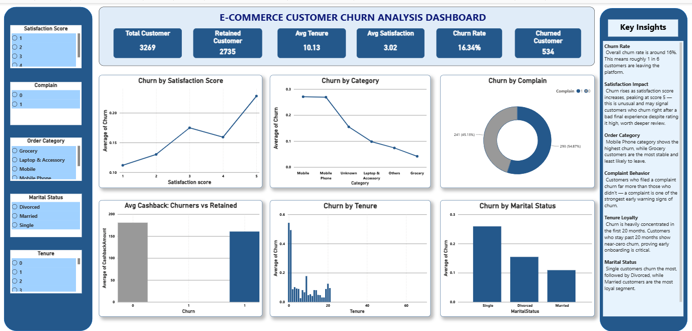

# 🛒 E-Commerce Customer Churn Analysis

**Python data cleaning + Power BI dashboard to find out which customers leave an e-commerce platform, and why.**



---

## 🎯 Business Problem
An e-commerce company is losing customers and wants to know:
1. How many customers churn, and what is the overall churn rate?
2. Which customer groups (category, marital status, tenure) churn the most?
3. Do complaints, satisfaction and cashback offers relate to churn?
4. Where should the retention team focus first?

## 🛠️ Tools & Skills
| Area | Details |
|---|---|
| Python (pandas, Jupyter) | Data cleaning and preparation (`notebooks/churn_analysis.ipynb`) |
| Excel | Cleaned dataset exported as `customer_churn_cleaned.xlsx` |
| Power BI | Interactive dashboard: KPI cards, 6 charts, 5 slicers, Key Insights panel |
| Analysis | Churn rate by segment, tenure analysis, complaint and satisfaction analysis |

## 🗂️ Project Structure
```
E-Commerce-Customer-Churn-Analysis/
├── data/
│   ├── customer_churn.csv            # raw data
│   └── customer_churn_cleaned.xlsx   # cleaned data used in Power BI
├── notebooks/
│   └── churn_analysis.ipynb          # cleaning and preparation
├── powerbi/
│   └── churn_dashboard.pbix          # dashboard file
├── images/
│   └── dashboard.png
└── README.md
```

## 📊 Headline KPIs
| KPI | Value |
|---|---|
| Total Customers | **3,269** |
| Retained Customers | **2,735** |
| Churned Customers | **534** |
| Churn Rate | **16.34%** |
| Avg Tenure | **10.13 months** |
| Avg Satisfaction Score | **3.02** |

## 🔍 Key Insights
1. **About 1 in 6 customers churns.** The churn rate is **16.34%** (534 of 3,269 customers).
2. **The first months are the danger zone.** Churn is highest right after signup (roughly half of customers in their first month or two) and falls steadily as tenure grows. The chart shows no churn after about 20 months, so early onboarding matters most.
3. **Mobile categories have the highest churn.** Both "Mobile" and "Mobile Phone" churn at about **27%**, against about **4%** for Grocery, the most stable category. Laptop & Accessory is about 10%.
4. **Complaints are a warning sign.** **293 of the 534 churned customers (54.9%)** had filed a complaint.
5. **Satisfaction behaves unexpectedly.** Churn rises from about **11%** at score 1 to about **23%** at score 5. That is the opposite of what you would expect, so the satisfaction score may not be a reliable early-warning signal and deserves a closer look (for example when the survey is collected).
6. **Single customers churn the most.** About **26%** of single customers churn, compared with about **15%** for divorced and **11%** for married customers.
7. **Cashback alone is not keeping people.** Churned customers received a slightly lower average cashback than retained customers (roughly 160 vs 180), so cashback may help but is not the main driver.

> Note: these are patterns in the data, not proof of cause.

## 💡 Recommendations
- **Build an onboarding programme** for the first 3 months (welcome offers, check-ins), since that is where most churn happens.
- **Fast-track complaint resolution** and treat any complaint as a churn-risk flag for follow-up.
- **Investigate the Mobile categories:** find out whether delivery, quality or pricing issues drive their ~27% churn.
- **Review the satisfaction survey:** check when it is collected and why high scores still churn.
- **Target single customers** with loyalty offers, as they are the highest-risk segment.

## 📐 Dashboard Features
- 6 KPI cards, 6 charts (churn by satisfaction, category, complaint, tenure, marital status, and average cashback), and a Key Insights panel
- Slicers for Satisfaction Score, Complaint, Order Category, Marital Status and Tenure, so every chart can be filtered interactively

## ▶️ How to Reproduce
1. Put `customer_churn.csv` in `data/`.
2. Run `notebooks/churn_analysis.ipynb` to clean the data and export `customer_churn_cleaned.xlsx`.
3. Open `powerbi/churn_dashboard.pbix` in Power BI Desktop. If the data source path is wrong, use **Transform data → Data source settings** to point it to your copy of the cleaned file.

## 👤 Author
**Irfan** - Aspiring Data Analyst
[LinkedIn](https://www.linkedin.com/) · [GitHub](https://github.com/iirfanshk)
